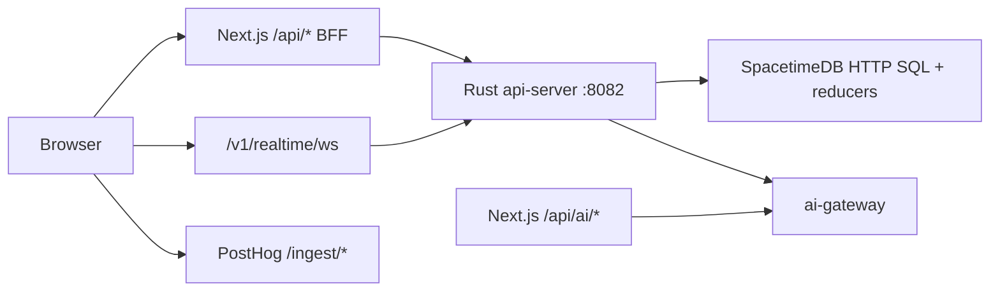

# Lumiere architecture

Canonical request flow for the Lumiere ERP web stack. For environment variables see [ENVIRONMENT.md](./ENVIRONMENT.md). For production deploy see [PRODUCTION_DEPLOY.md](./PRODUCTION_DEPLOY.md).

## Request flow



### Browser → ERP data

1. React app uses `@lumiere/api-client` (`apiFetch`) for `/api/query/*` and `/api/call/*`.
2. Next.js route handlers under [`frontend/web/app/api/`](../frontend/web/app/api/) forward most ERP paths to the Rust api-server via [`frontend/web/lib/api-server-forward.ts`](../frontend/web/lib/api-server-forward.ts) (`LUMIERE_API_SERVER_URL`).
3. In hosted mode, AuthKit verifies/refreshes the sealed browser session and the BFF forwards its WorkOS access token. api-server verifies the provider identity and live session, resolves tenant membership and policy, then calls SpacetimeDB using a server-held credential.
4. Native development/self-hosted mode accepts a `stdb_token` cookie or bearer token. Optional direct gateway routing through `NEXT_PUBLIC_API_GATEWAY_URL` applies only to native mode; hosted mode requires same-origin routing.

### Authentication authority

| Concern | Source of truth | Implementation |
|---------|-----------------|----------------|
| Identity, verified email, authentication and provider-session revocation | WorkOS | AuthKit browser integration; API-side verification in [`session/workos.rs`](../api-server/src/session/workos.rs) |
| Hosted API mode and provider setup | Validated `Config.workos_auth` | `WorkosAuthConfig::from_env`; session resolution, native-route guards and realtime all use this same configuration |
| Browser transport mode | Server-owned `WORKOS_CLIENT_ID`, matching the API deployment | [`auth-mode.ts`](../frontend/web/lib/auth-mode.ts); never selected from public browser configuration |
| Callback URL | Runtime `WORKOS_REDIRECT_URI`, with legacy public fallback | [`workos-config.ts`](../frontend/web/lib/workos-config.ts); production requires HTTPS and the exact callback path |
| Request credential selection | Explicit authorization first, otherwise the configured browser session | [`auth-credentials.ts`](../frontend/web/lib/auth-credentials.ts), shared by BFF and SSR; hosted sessions never fall back to native cookies or development credentials |
| WorkOS subject to platform/STDB identity binding | PostgreSQL platform control plane | [`platform_control/workos.rs`](../api-server/src/platform_control/workos.rs); exact operator-approved linking, never email-only linking |
| Tenant membership, roles, business permissions and invitation acceptance | Lumière's organization authority in SpacetimeDB | API resolves current access; reducers enforce mutations; shared Rust policy evaluation in `crates/stdb-auth` and `crates/policy-core` |
| Editable application profile | PostgreSQL profile with durable tenant projection | `routes/auth/profile.rs`; WorkOS owns the verified email |

WorkOS authentication establishes who the caller is. Provider roles or display
names do not grant ERP access. The alpha admissions list is an operator-owned
release restriction checked by the API in addition to provider verification;
it is not a separate password or session system. Its pinned email and
organization must be updated deliberately when provider details change.

Next.js contains no credential database, password hashing, identity provisioning
or native-token saving action. Cookie cleanup lives in the server-only
[`auth-cookies.ts`](../frontend/web/lib/auth-cookies.ts) library. Native password
support remains in the Rust API for development/self-hosting and is disabled
whenever WorkOS is configured. Service and device credentials remain separate
from interactive user authentication.

Web and API processes must receive the same WorkOS client ID. Invalid configured
provider settings stop API startup; missing configuration still selects native
mode, so deployment checks must ensure both processes receive hosted settings.
See [production setup](./PRODUCTION_DEPLOY.md#workos-alpha-admission) and
[hosted lifecycle](./plans/workos-lifecycle-completion.md) for admission, migration
and live validation requirements.

### Frontend contracts compatibility

- Frontend packages pin the generated `@lumiere/contracts` release to a vendored tarball under `frontend/vendor/`.
- The container build verifies that every frontend consumer uses the same tarball, that its filename and package metadata versions agree, and that the frozen lockfile records the pin.
- Runtime services therefore do not depend on a contracts HTTP endpoint; contract drift fails the immutable application build instead of production startup.

### Realtime

- Browser WebSocket: same-origin `/v1/realtime/ws` (Kong) or `ws://127.0.0.1:8082/v1/realtime/ws` in local dev.
- api-server bridges SDK subscriptions to the client; see [`api-server/src/realtime/`](../api-server/src/realtime/).

### Query registry (Rust → TypeScript)

- **Source of truth:** [`crates/stdb-auth/assets/resource_registry.json`](../crates/stdb-auth/assets/resource_registry.json)
- **Codegen:** `make codegen` (`lumiere-codegen`) emits:
  - `frontend/packages/stdb/src/generated/query-registry.ts`
  - `stdb-generated-sql-columns.json` (frontend + `crates/stdb-auth/assets/`, from `generated/*_table.ts` + `types.ts`)
  - `erp-org-sql.json` (from `ERP_ORG_SQL` in `erp-subscriptions.ts` → Rust `erp_subscriptions.rs`)
  - `query-resource-row-type.json` copy (Rust asset → frontend)
  - `stdb-reducer-invalidation.ts` (from `lumiere-codegen/reducer-stdb-invalidation.json` → `useStdbCallMutation` manifest)
- **Query exec audit:** `query_exec_non_registry.json` allowlists virtual resources with custom SQL in `api-server/src/query_exec.rs` that are outside `resource_registry.json`; `make codegen` fails if arms drift from the allowlist.
- **CI:** `make check-codegen` fails if generated artifacts drift
- **Browser reads:** `GET /api/query/:resource` via api-server `query_exec.rs` (aligned with registry keys)
- **SSR reads:** All module RSC pages use `serverFetchQueryList` / `serverFetchQueryListsAllowEmpty` in [`frontend/web/lib/server-query.ts`](../frontend/web/lib/server-query.ts) → `GET /v1/query/:resource` on api-server
- **Admin SQL:** `@lumiere/stdb/server` exports `stdbSql` + entity types for Next.js auth/admin route handlers only

### AI

- Next.js `/api/ai/*` routes proxy to **ai-gateway** (RAG, action drafts, skills).
- The BFF resolves the browser session through the API authority. The AI gateway authenticates the sending service separately using its internal gateway secret.
- [`lumiere-auth-context`](../crates/auth-context/src/lib.rs) is the shared Rust contract between api-server and ai-gateway: actor headers, company/organization scope, capability-grant envelopes and the API authority client. API forwarding and gateway evidence, descriptor, lifecycle and header-based governed-skill parsing use the same actor contract. Header parsing validates shape; it does not authenticate a user.
- Evidence and generated-tool grant resolution use the same shared client to recheck the caller through `/v1/ai/capability-grants`. Requests carry the original API credential, which may be a WorkOS access token. Each response must match the exact identity, organization and company. Missing, malformed, denied or unavailable authority fails closed; grants are not cached across requests. Generated execution also requires the server-owned placement and policy-generation fields.
- WorkOS verification and identity binding stay in api-server. The AI gateway has no independent WorkOS configuration, JWKS cache or password flow. Dedicated AI runtime, certification and spend-read credentials serve their existing machine roles; they do not replace the acting user's authority.
- Native SpacetimeDB writes remain distinct from API calls: a hosted WorkOS token must never be passed to `StdbClient::with_token`. The shared actor token is an API credential. Existing legacy STDB-token transports are compatibility paths, not another identity authority; moving them to the API transport is a separate migration.

### Analytics

- PostHog browser SDK sends events to same-origin `/ingest/*` (rewritten in [`frontend/web/next.config.mjs`](../frontend/web/next.config.mjs)).
- Server events use [`frontend/web/lib/posthog-server.ts`](../frontend/web/lib/posthog-server.ts).

## Service ownership

| Service | Path | Owns |
|---------|------|------|
| **Next.js web** | `frontend/web/` | App shell, SSR, BFF forward, `/api/ai/*`, WorkOS browser-session transport and login/logout redirects |
| **api-server** | `api-server/` | Verified API session, identity binding, tenant access resolution, `/v1/query`, `/v1/call`, typed REST (CRM, sales, …), realtime WS |
| **SpacetimeDB module** | `spacetimedb/` | Tables, reducers, permissions, audit, domain logic |
| **ai-gateway** | `ai-gateway/` | LLM, RAG, embeddings, action draft orchestration |
| **Kong** | `infra/kong/` | Production path routing (`/api/query`, `/api/call`, web, ai-gateway) |

## Local development

```bash
# Terminal 1 — SpacetimeDB
spacetime start

# Terminal 2 — publish module
spacetime publish lumiere-v1-j1uo0 --module-path spacetimedb --server local -y

# Terminal 3 — api-server
LUMIERE_API_SERVER_URL= cargo run -p api-server   # or rely on Next forward default :8082

# Terminal 4 — Next.js
cd frontend/web && pnpm dev
```

Full browser smoke (includes seed + Playwright):

```bash
make e2e-smoke
```

## Staging / production

- Docker Compose + Kong front door — see [PRODUCTION_DEPLOY.md](./PRODUCTION_DEPLOY.md).
- `make check-env-prod` validates required secrets before deploy.
- Production api-server enforces `STDB_SERVER_TOKEN`, non-localhost `AI_GATEWAY_URL`, and (when enabled) reducer allowlist — see `LUMIERE_REDUCER_ALLOWLIST` in [ENVIRONMENT.md](./ENVIRONMENT.md).

## Gateway consolidation (complete)

Historical plans under `.cursor/plans/` tracked migrating the web stack off direct SpacetimeDB WebSocket + duplicated TS query layers. Status as of 2026-07:

| Track | Outcome |
|-------|---------|
| Registry + codegen (`lumiere-codegen`) | `resource_registry.json` → query-registry, SQL columns, erp-org-sql, reducer invalidation; `make check-codegen` in CI |
| SSR reads | All module `page.tsx` → `serverFetchQueryList` → api-server `query_exec.rs` |
| `@lumiere/stdb` surface | Main barrel: `DbConnection`, `erp-subscriptions`, `auth` only; domain hooks live in `@lumiere/query-hooks` |
| STDB WebSocket proxy | Removed `server.js`; `next dev` / `next start`; realtime via api-server `/v1/realtime/ws` + `useLumiereRealtime` |
| HTTP SQL `IN (...)` | `query_exec.rs` uses org scope or Rust-side filters; subscriptions use `col = id OR …`; see [company-id-in-sql-fix-plan.md](./company-id-in-sql-fix-plan.md) |
| Session security | No anonymous `STDB_SERVER_TOKEN` sessions; see [SECURITY.md](./SECURITY.md) |
| Call invalidation | `useStdbCallMutation` + generated `STDB_REDUCER_INVALIDATION` manifest |

## Deprecated docs

- [`frontend/web/PHASE0_IMPLEMENTATION.md`](../frontend/web/PHASE0_IMPLEMENTATION.md) — historical; referenced removed `server.js` STDB WebSocket proxy. Current stack uses api-server realtime bridge.

## Related

- [MVP workflow contract](./MVP_WORKFLOW_CONTRACT.md) — acceptance steps and E2E status
- [Reducer coverage matrix](./reducer-coverage-matrix.md) — backend ↔ UI wiring
