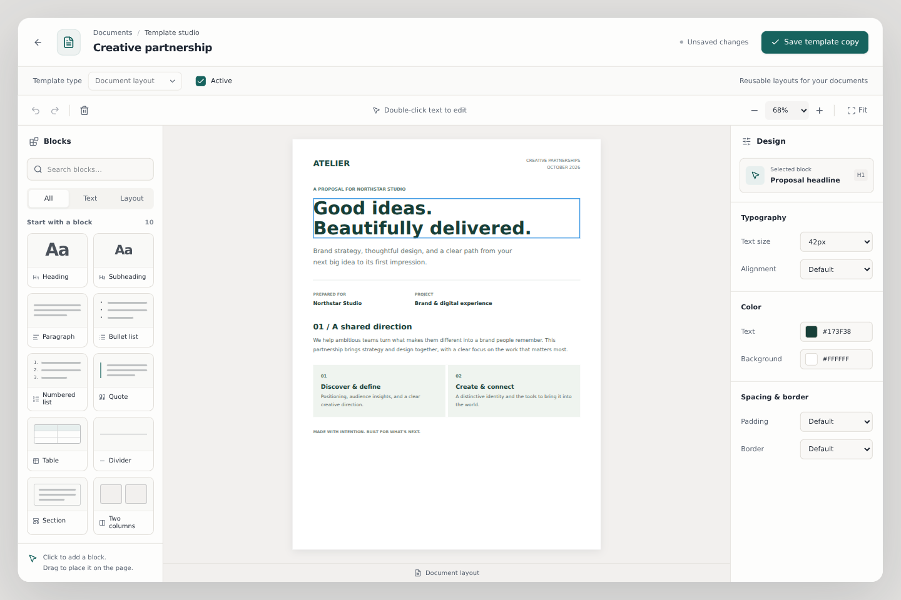
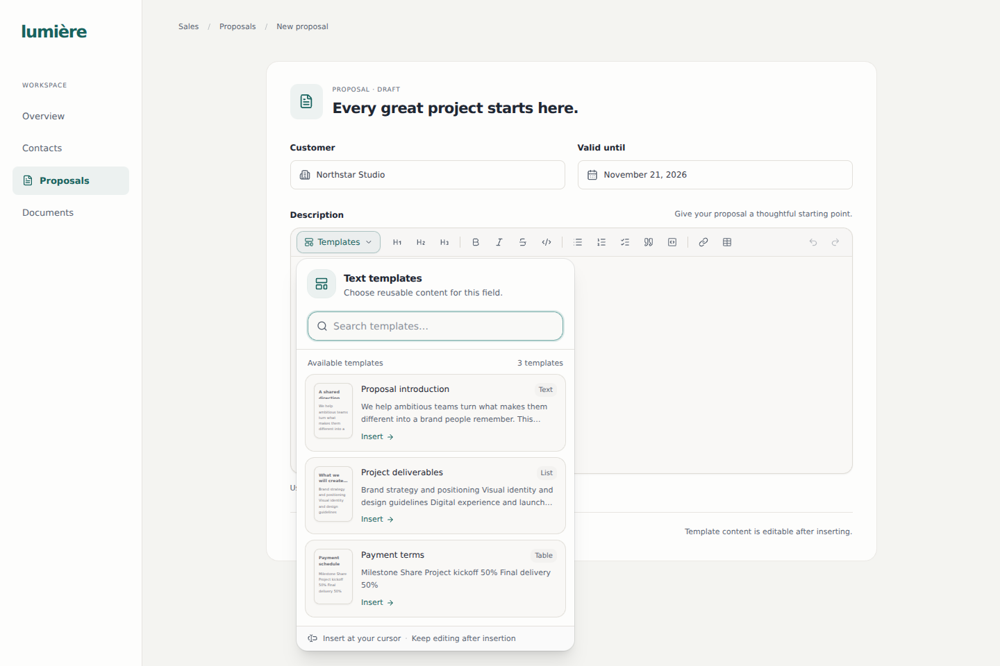

# GrapesJS templates and Tiptap fields

## Implemented scope

This change builds on PR #233 (`feat/tiptap-rich-text`). GrapesJS **open-source core 0.23.8** provides visual template authoring. Existing Tiptap **3.31.4** editors continue to handle Markdown fields in forms and modals. Neither integration needs a vendor account, API key, Studio SDK or paid Tiptap extension.

In **Documents → Document templates**, **New template** opens the visual designer. Users can start with a blank canvas or a supplied starter, save for the active company, then edit, rename, duplicate, deactivate or reactivate a supported template. In a rich text field, **Templates** inserts an active text template at the selection; users can edit and save the inserted text through the field's existing Markdown contract.

The first complete document-output consumer is a **sales quotation**. Select a draft quotation in **Sales → Orders**, choose **Create quotation PDF**, select a document layout, review its populated preview and save the PDF. The generated file is attached to that sales order in Documents with its original bytes and source snapshot.

| Template type | Authoring | Consumption |
| --- | --- | --- |
| Text for editor fields | Headings, paragraphs, lists, quotes, tables, dividers; inline bold/italic/strike | Tiptap insertion followed by the field's existing Markdown persistence |
| Document layout | Text blocks, sections, two-column tables, presentation controls, quotation fields and a managed brand logo | Authorized sales quotation preview followed by an immutable PDF snapshot in Documents |

Whole page layouts are deliberately absent from the prose picker. Markdown cannot preserve positioning, page styles, arbitrary containers or fonts. These are two projections of a shared template record, not two independent mutable copies of the same field.

## Template studio interface

The editor uses the application's mineral surfaces and teal accent, with an inline template name and a persistent Save action. A searchable block library, page workspace and separate properties inspector provide the main authoring areas. Blocks have visual previews, text/layout filters and both click-to-add and pointer drag placement. The inspector groups the selected block's typography, colors, spacing and border controls.

Canvas zoom and Fit change the editing viewport without changing the saved project. At narrower widths the inspector and block library open as side panels, keeping the canvas mounted and visible. The phone layout fills the viewport and retains the Save action at the top. Touch users can tap blocks to insert them. An outline, **Edit text**, and **Move up/down** controls provide a keyboard path for selecting, editing and reordering blocks.

Starters include reusable proposal, scope and terms text, plus a quotation document layout. The document library distinguishes loading, failed, denied and empty states and provides an explicit retry. The studio, picker and quotation dialog have English and Brazilian Portuguese strings; unrelated application surfaces retain their existing fallback.

The Tiptap picker presents searchable cards with inert previews of sanitized template content, a content-type badge and an Insert action. It retains the existing captured-selection insertion and Markdown persistence. The field itself has a lighter toolbar, a roomier writing area and a visible accent for active formatting.

The previews below render the actual editor components with sample content and a local API adapter. The surrounding proposal form in the second image is a preview fixture.





## Storage and rendering contract

The existing `document_template` row remains the persisted entity; no new table or schema field is introduced. The canonical operation catalog now exposes the existing, permission-checked `update_document_template` reducer to authenticated sessions. The normal contracts release workflow regenerates and pins the corresponding typed transport. No legacy reducer transport or handwritten generated descriptor is used.

```ts
metadata.documentDesigner = {
  schemaVersion: 1,
  engine: "grapesjs",
  kind: "rich-text" | "document",
  project: { assets: [], styles: [], pages: [/* one validated frame */] }
}
```

The validated project is the editing source. `body_html` is compiled from that project and sent with its metadata in one create or update operation. Other metadata keys, model and default status are retained when editing or duplicating. Invalid JSON or unsupported designer versions cannot silently overwrite stored state. New records use `lumiere-rich-text-template-v1` or `lumiere-document-layout-v1` as their report type; their generic backend model is `document`. Copies preserve the source model.

The text picker derives HTML from the validated project rather than trusting a separately edited `body_html` value. Tiptap parses that semantic HTML with its existing schema. Insertion dispatches one content transaction, emits the normal Markdown update, and passes through the existing hidden native textarea bridge. Form submission, `name`, `ref`, focus, keyboard handling and controlled values keep the same contract.

Document canvas styles and exported defaults come from the same versioned style map. The HTML projection includes those defaults inline, with authored per-block overrides. Text fragments keep the consuming field's typography. Project JSON is necessary for reopening; an HTML export alone is not an equivalent authoring source.

## Template lifecycle

**Edit** updates the existing template and retains its identifier. **Duplicate** creates a separately named record. **Deactivate** removes a template from new insertions and quotation selection without deleting previously inserted content or generated documents; **Reactivate** makes it available again. Template creation requires `document_template:create`; editing and active-state changes require `document_template:write`.

The reducer checks organization/company ownership, rejects whitespace-only names or bodies, preserves omitted metadata, and records lifecycle changes in the audit trail. A true no-op still checks permission but does not create a misleading write or audit event. Reserved invoice profiles keep their existing validation. Editing is a single-author save; automatic conflict merging and collaborative editing are outside this change.

## Scope, lifecycle and content boundaries

- The web provider fetches on first template request and shares the result across fields. Query cache keys include organization, identity and active company. Scoped requests include the active company, and the API returns only templates from an authorized company or explicit organization-global scope. Missing, conflicting or malformed scope values fail closed. Browser filtering is an additional guard, not the authorization boundary.
- Both provider and designer require a ready session, matching RBAC identity and appropriate template permissions. Company/identity changes discard stale picker choices and designer scope. Revoking read access removes the picker while retaining the form and its unsaved text.
- Only active, valid text templates reach the picker. Legacy HTML, page layouts, malformed/future designer versions and reserved invoice profiles are excluded.
- Selection is captured when the picker opens. If the document changes while the picker is open, insertion is rejected rather than applied at an uncertain location. Character limits are checked before dispatch, and an inserted template has its own undo step.
- Save failures keep the design open. Close/navigation guards protect dirty state and block closing while a save is pending. A synchronous save guard prevents duplicate submissions.
- GrapesJS loads only when the designer mounts and is destroyed on unmount. Its default storage, autosave, telemetry, external icon CSS, built-in asset uploads, scripts, external drops and remote canvas resources are disabled. Application saves use the normal ERP commands.
- Project validation admits one page/frame, a bounded tree of built-in components and a restricted set of presentation properties. Scripts, custom component types, global CSS rules, external assets and live data sources cannot be loaded. Unknown model behaviors and wrapper head/document properties are stripped.
- DOMPurify plus explicit attribute, URL and CSS handling sanitizes pasted/exported HTML. Content is bounded to 1 MB of UTF-8 data, 2,000 components and 32 nested component levels.

## Quotation preview and PDF output

The browser posts only company, order and template identifiers to `/api/documents/quotations/:id/preview`. The API resolves the current session and company membership, reads the authorized records with their field masks, validates the saved project, and compiles it on the server. It never accepts browser-supplied HTML or quotation amounts as the source of a PDF.

Supported scalar fields are:

| Group | Fields |
| --- | --- |
| Company | `company.name`, `company.address`, `company.tax_id` |
| Customer | `customer.name`, `customer.address`, `customer.email` |
| Quotation | `quotation.reference`, `quotation.date`, `quotation.valid_until`, `quotation.currency`, `quotation.subtotal`, `quotation.tax`, `quotation.total` |

Use `{{field.name}}` in text. Standalone blocks provide `{{quotation.line_items}}`, `{{quotation.notes}}`, `{{quotation.terms}}` and `{{company.logo}}`. Notes and terms render the existing stored Markdown through a restricted HTML sanitizer. Line items use stored ERP quantities, prices, discounts and amounts; the renderer does not recalculate financial totals. Unsupported variables fail validation instead of evaluating arbitrary expressions.

A brand logo is uploaded through the existing managed document-blob flow and saved as a checksum-pinned `metadata.documentBranding` reference. Only verified PNG/JPEG images up to 2 MiB are supported. Preview and PDF read the authorized, pinned bytes; arbitrary remote images, SVG, scripts and external canvas resources are not accepted. Generic image placement and a brand asset library are separate capabilities.

Preview requires company, customer, sales-order, order-line and template read access. Generation additionally requires document create and read access. Required business fields must also be visible through the user's field permissions; the default projections include the required values without overriding explicit masks. Version-history readback uses the existing document-version read permission.

The preview returns a revision derived from the renderer version, template and populated source. Saving requires that exact revision. The server checks it before rendering and checks again after Chromium finishes, rejecting a stale preview with HTTP 409. The iframe preview is sandboxed. A double-click guard prevents concurrent submissions, and an ambiguous save failure asks the user to check Documents before trying again.

PDF generation uses the existing `chromium-worker` at `REPORT_RENDERER_URL`. A generated file is stored as a company-owned blob and registered with the canonical `create_document` command, linked by `res_model = sale_order`. The initial `DocumentVersion` captures the template project, source values, revision and checksum. Later template edits, document metadata edits or new document versions do not replace that original version's provenance or bytes. Downloads recheck current company and document/version visibility, verify the checksum, and read the stored PDF without re-rendering a current template.

The output is a quotation export; it does not send the quotation, change its sales state or issue a fiscal document. A deliberate new generation creates another saved document. The project remains a single authoring canvas; long tables paginate in the PDF renderer. Source snapshots are capped at 1 MB, preview HTML at 6 MiB and PDF bytes at 8 MiB.

## Validation and release gates

Focused tests exercise real Tiptap and real GrapesJS core, including project serialization/reopening, table semantics, escaped text, styles, script/resource rejection, Markdown round trips, native `FormData`, selection, character limits, disabled/read-only fields and undo. Provider tests cover loading/error/retry, scope and permission changes, discovery and filtering. Dialog tests cover create/update/copy, active state, starters, logo handling, failed saves, discard guards and duplicate submissions. Quotation client/dialog tests cover exact identifiers, preview revisions, canceled or stale responses, read-only access and pinned download URLs.

Chromium component checks cover pointer dragging at 50% zoom, canceled drags, click-to-add, undo, immediate save/reopen, inspector changes, keyboard editing and template insertion. Responsive checks cover desktop, tablet and phone dimensions. A 120-line quotation compiled by the actual Rust renderer and printed by the existing Chromium worker produced six A4 pages: every line appeared exactly once, each page repeated headings and page numbers, and the final amount matched the source.

The real ERP acceptance specifications use provisioned ordinary staff, persisted records and actual APIs, with no mocked success paths:

- `document-template-studio.spec.ts`: create, reload, edit, duplicate, deactivate/reactivate, insert into a CRM contact modal, edit text, save and reopen; separate reader and cross-company denial cases.
- `quotation-document-studio.spec.ts`: create a real sales order and quotation layout, preview as staff, reject a concurrent template change, generate/download a PDF, verify its Document and initial DocumentVersion, edit the template again and verify the saved bytes and provenance remain unchanged.

The in-module document test aggregate covers template lifecycle validation and immutable version provenance. API tests cover company filtering, quotation projections/compiler limits, escaping, Markdown, revisions and stored PDF handling. The authorization crate tests default projections and explicit field masks. Existing invoice-renderer regressions stay in place.

Run the relevant UI tests with:

```sh
cd frontend/packages/ui
./node_modules/.bin/vitest run \
  src/lib/document-template-designer.test.ts \
  src/components/document-template-designer.test.tsx \
  src/components/rich-text-template-picker.test.tsx \
  src/components/textarea.test.tsx \
  src/lib/rich-text-extensions.test.ts \
  src/documents/document-template-provider.test.tsx \
  src/documents/document-template-designer-dialog.test.tsx \
  src/documents/quotation-document-dialog.test.tsx
```

Transport tests live in `frontend/packages/query-hooks/src/hooks/templates.test.ts` and `quotations.test.ts`. Large workspace type checks may require `NODE_OPTIONS=--max-old-space-size=6144`. The hosted E2E workflow starts the real PDF worker with its installed Playwright Chromium and runs the new specs. CI also covers stacked feature PRs, full API compilation and the focused quotation/storage Rust tests.

Local full API compilation exceeded this workspace's memory budget in the generated contracts SDK. An isolated harness can validate the actual compiler and invoice-renderer source, but it does not replace hosted API compilation or ERP acceptance. The PR must retain those gates; adding or collecting a Playwright spec is not evidence that its scenario passed.

## Next integration boundaries

Sales quotations are the first bound document model. Purchase orders, arbitrary reports and invoices need their own explicit projection and output lifecycle before reusing the same approach. Existing invoice personalization and issued-document snapshots keep their current pipeline.

Merge fields remain literal in reusable Tiptap text; record-aware expansion occurs only in the quotation renderer. Durable offline saving, automatic reconnect, multi-page freeform authoring, generic image/brand asset management, DOCX export, collaborative cursors and automatic edit-conflict merging remain separate capabilities.

## Library references

- [GrapesJS project persistence](https://grapesjs.com/docs/modules/Storage.html)
- [GrapesJS editor API and lifecycle](https://grapesjs.com/docs/api/editor.html)
- [GrapesJS custom rich text editor API](https://grapesjs.com/docs/guides/Replace-Rich-Text-Editor.html) — available if later embedding Tiptap directly inside the canvas is useful.
- [Tiptap insertion commands](https://tiptap.dev/docs/editor/api/commands/content/insert-content-at)
