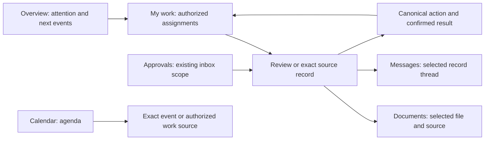

# Productivity workspaces for the Finance alpha

**Status:** Implemented for PR review. Authenticated alpha acceptance and deployment remain separate.
**Date:** 2026-10-28.
**Planning snapshot:** `48aa5912`, including Accounting guided workflows (#293). Implementation starts from current main below.
**Current main checked through GitHub:** `eeb44cf50474697da2a19f28841a74e13df6cf2c`, including Reports #298, Sales #294 and CRM #295. The [comparison](https://github.com/KevTiv/lumiere-v-1/compare/48aa5912...eeb44cf50474697da2a19f28841a74e13df6cf2c) changes the shared workspace navigation and adds CRM daily work; it does not change the three productivity module clients reviewed below. Start implementation from current main and recheck these assumptions.

## Recommendation

Make the included productivity tools places where an alpha user can finish daily work: find an assignment, review its source, open its documents or conversation, perform a permitted action, and return to the same queue. Carry forward the Finance approach: useful queues, a next step with its prerequisites, exact record links, and distinct empty, unavailable and restricted states.

My recommendation is to deliver five slices in the order below. The first two establish truthful navigation and daily work. The remaining slices make the existing Documents, Calendar and Messages workspaces useful at arrival. This order is a product judgment, not a measured user preference.

## Scope and preservation

The Productivity navigation group includes **Documents, Calendar and Messages** in `finance-alpha`. **Overview, My work and Approvals** are supporting entry points and belong in this plan where the same journey crosses them. Proposals is in the full catalog but excluded from this alpha profile. Projects stays a separately gated destination, including existing `/tasks?source=projects` handoffs.

Journal, Notebook and ERP Assistant remain existing panels. Preserve their launchers and current gates; a new notes application, notebook redesign or AI workflow is outside this slice. Workspace visibility never overrides first-organization admission or destination permissions.

Preserve Lumiere's theme, typography, existing shadcn wrappers, Lucide icons, responsive shell, translations, canonical forms, record pages, mutations and access boundaries. Keep existing tab IDs and direct links working. Advanced functions move into grouped navigation, not out of the product.

Use the current [Finance navigation scope](../plan/finance-alpha-navigation-status.md), [work-board contracts](../plan/module-work-boards-alpha.md) and [change-review plan](finance-alpha-change-review-plan.md) as constraints. A new UI does not imply new review adapters or history coverage.

## What the source establishes

This is a code and reference audit. The Accounting evidence screenshot was inspected; the productivity routes were not run in an authenticated browser. Confirm their rendered behavior with baseline captures before implementation.

| Finding | Evidence | Consequence for the plan |
| --- | --- | --- |
| Documents, Calendar and Messages all default to a dashboard tab. | `documentsModuleConfig`, `calendarModuleConfig`, `messagesModuleConfig` in [module-dashboard-configs.ts](../../frontend/web/lib/module-dashboard-configs.ts). | Open the working view by default; retain dashboards as explicit secondary destinations. |
| Documents already has a file browser with grid/list, folders, search, upload and record navigation. Its config exposes ten tabs. | [documents-client.tsx](../../frontend/web/app/(modules)/documents/documents-client.tsx), [file-browser.tsx](../../frontend/packages/ui/src/documents/file-browser.tsx). | Promote and refine this browser; rebuilding it would repeat existing work. Group knowledge, templates and management tools. |
| Calendar has event CRUD, month/week/day views, search, an event panel and exact event pages. Its view/date/selection are local React state. | [calendar-client.tsx](../../frontend/web/app/(modules)/calendar/calendar-client.tsx), [calendar-view.tsx](../../frontend/packages/ui/src/calendar-components/calendar-view.tsx). | Add a daily agenda and restorable navigation around the existing owner operations. |
| Overview's productivity widget reads `ProjectTask`; its Today list admits tasks due within seven days and undated tasks. `/tasks` instead opens Finance work, with workflow and Activity sources selected separately. | [use-productivity-sections.ts](../../frontend/web/lib/use-productivity-sections.ts), [productivity-data.ts](../../frontend/web/lib/productivity-data.ts), [my-work-client.tsx](../../frontend/web/app/(modules)/tasks/my-work-client.tsx), [work-board-workspace.tsx](../../frontend/web/components/work-board/work-board-workspace.tsx). | Overview and My work must agree about the source and meaning of a queue. Preserve the project view separately. |
| Overview's “New task” and “New event” shortcuts navigate to `/tasks` and `/calendar`; they do not launch creation themselves. | [overview-client.tsx](../../frontend/web/app/(modules)/overview/overview-client.tsx). | Use “Open my work” for navigation; make “New event” actually reach the existing create flow. |
| The work board supports Purchasing, Sales, Accounting and Expenses workflow subjects; record follow-ups support a subset. New main adds a separate CRM daily-work panel. | [work-board-model.ts](../../frontend/packages/query-hooks/src/hooks/work-board-model.ts), work-board scope document, [CRM panel at checked main](https://github.com/KevTiv/lumiere-v-1/blob/eeb44cf50474697da2a19f28841a74e13df6cf2c/frontend/web/app/(modules)/crm/crm-my-work-panel.tsx). | Do not advertise every Finance module as supported by one board. Link to CRM's daily work until an explicit aggregate adapter exists. |
| Approvals uses its own inbox and formats titles from subject model/ID and node key. | [approvals-client.tsx](../../frontend/web/app/(modules)/approvals/approvals-client.tsx). | Add authorized business context and a review panel while preserving the inbox's broader entitlement and source scope. |
| Messages already has exact message pages, replies, follow controls, typed record choices and notification-read hooks. Its list client compares generated message-type objects using `String(...)`, including a documented notification mismatch. | [messages-client.tsx](../../frontend/web/app/(modules)/messages/messages-client.tsx), [message-record.ts](../../frontend/web/app/(modules)/messages/message-record.ts), [messages hooks](../../frontend/packages/query-hooks/src/hooks/messages.ts). | Repair classification before designing counts and filters. Reuse `messageKind`/the existing enum reader and verify actual wire shapes. |
| Recent knowledge notes all link to the knowledge-base tab, rather than selecting the clicked article. | `recentNotes` in [productivity-data.ts](../../frontend/web/lib/productivity-data.ts). | Add exact article focus through the existing entity sheet/navigation contract. |

## Reference decisions

### Mobbin screens inspected

These are web references. They show interface structure, not evidence that a layout changes alpha adoption or task completion time.

| Reference | Visible pattern to borrow | Boundary |
| --- | --- | --- |
| [incident.io: My tasks](https://mobbin.com/screens/8607a8d1-6cb2-4107-a009-054f34235419) and [Plane: Your work](https://mobbin.com/screens/7e08d076-9297-4567-99d6-2e3a8c6dab3e) | Task lists with status, due information, filters and a completed-work destination. This is precedent across two products for making the list the working surface. | Preserve Lumiere's distinct workflow, follow-up and project owners. |
| [Quo: task with conversation](https://mobbin.com/screens/333f2c13-59f8-4cb3-ac17-a1ec72d89837) | Selected task and its conversation remain visible beside the list. | Structural example for source context; its “Mark complete” does not justify completing a financial approval with a checkbox. |
| [Calendly: calendar agenda](https://mobbin.com/screens/08754a6e-10eb-45aa-9148-eb41910d9262) | Date-grouped events with the selected meeting's details beside the agenda. | One example for the agenda direction; provider scheduling, joining and rescheduling capabilities are not assumed. |
| [Quo: inbox](https://mobbin.com/screens/6160a5d6-c884-46f0-804d-c872f19278cc) and [Meetup: messages](https://mobbin.com/screens/3e363b1a-848e-4cbb-902a-30f759775200) | Conversation list beside the selected thread and composer. | Meetup supplies structure only from a different domain. Lumiere remains record-linked business messaging. |
| [hilos: Docs](https://mobbin.com/screens/1f2a4f64-13aa-46b5-8769-53a7159c18b5) and [WeTransfer: Transfers](https://mobbin.com/screens/660d3c70-3835-4e73-b499-566ae4288c72) | Folder organization in hilos; search and an explicit selected-item action bar in WeTransfer. | Separate examples. Neither proves an invoice-preview flow. Bulk file actions require Lumiere owner support before being offered. |

Other returned screens were not adopted: a design-file gallery, file-picking dialogs, campaign planning and meeting AI tools do not establish the alpha's record workflows.

### Shadcn UI Kit and GitHub

The requested [default dashboard](https://shadcnuikit.com/dashboard/default) provides a shell and content layout reference. Its linked GitHub owner is Bundui; the matching public repository is [bundui/shadcn-ui-kit](https://github.com/bundui/shadcn-ui-kit). This is independent of the official [shadcn-ui/ui](https://github.com/shadcn-ui/ui) repository.

The site was read through its page content, and the following public source files were inspected. The demo was not interactively tested or visually captured. Its [README](https://github.com/bundui/shadcn-ui-kit/blob/main/README.md) separates the free edition from Pro. Do not assume the complete live Mail, Calendar or File Manager apps are in the public source.

| Source | Use in Lumiere |
| --- | --- |
| [Task demo](https://shadcnuikit.com/dashboard/apps/tasks) | Search, filters, task status and priority in one working list. Implement using the existing work renderer and its real pagination. |
| [Mail demo](https://shadcnuikit.com/dashboard/apps/mail) | List/detail workspace as an ideation reference. Offer read/unread only for sources with durable read state; its archive, snooze, junk and forwarding controls are not alpha requirements. |
| [Calendar demo](https://shadcnuikit.com/dashboard/apps/calendar) | A calendar toolbar with Today, current period, view selection and New event. Add Lumiere's agenda without replacing its event owner. |
| [File Manager demo](https://shadcnuikit.com/dashboard/apps/file-manager) and [Notes demo](https://shadcnuikit.com/dashboard/apps/notes) | Navigation references for Files and Knowledge within Documents. Their presence does not warrant adding another notes store. |
| [Public header](https://github.com/bundui/shadcn-ui-kit/blob/main/components/admin/site-header.tsx) | Compact page header and sidebar control. Keep Lumiere's existing company context and command search. |
| [Public data table](https://github.com/bundui/shadcn-ui-kit/blob/main/components/admin/data-table.tsx) | Responsive view selector, column menu and table controls. Its in-memory sorting, paging and sample counts must not become claims about server-wide results. |
| [Public todo block](https://github.com/bundui/shadcn-ui-kit/blob/main/contents/blocks/application-ui/todo-app/1/index.tsx) | Compact follow-up row as a visual example. Its local `useState` persistence and arbitrary create/delete semantics are unsuitable for ERP assignments. |
| [Official shadcn dashboard block](https://github.com/shadcn-ui/ui/tree/main/apps/v4/registry/new-york-v4/blocks/dashboard-01/components) | Secondary implementation reference for composing existing primitives. The directory was verified; no new component-library migration is needed. |

## Proposed screen structure

Keep the global shell and Finance navigation. Use the same module workspace navigation contract already introduced for Finance; extend its metadata for productivity without a global shell rewrite.

| Entry | Working landing page | Primary control | Secondary destinations retained |
| --- | --- | --- | --- |
| Overview | Finance attention queues, My work summary and next events | Open the selected queue/item | Existing owner metrics and authorized project handoffs |
| My work | Assigned workflow work, with an explicit Record follow-ups selector | Open review or source | Available/eligible work, module/team filters, list/board, CRM daily-work handoff, gated project tasks |
| Approvals | Review queue with business subject and current eligibility | Review selected assignment | Claim, decision/comment and delegated-principal controls in their current scope |
| Documents | Files browser | Upload | Knowledge, Templates, and Manage groups; Dashboard remains available |
| Calendar | Agenda on narrow screens; agenda/calendar choice on wide screens | New event | Event table, Activities and Dashboard |
| Messages | Conversation list and selected thread | Reply, or New message when no thread is selected | Notifications, Message batches, Following and Dashboard |

The default wide-screen composition is a heading and one toolbar above the work list, with a selected-item panel where the job needs context. On narrow screens, selection opens a full-width detail view with Back to list; the composer and decision controls remain reachable above the software keyboard. Keep filter and selection state on return. Exact breakpoints and panel widths are implementation choices to settle against real content.

Arrows describe intended navigation. They do not imply that a missing backend relationship or adapter already exists.

## Delivery slices

### PROD-01: working defaults, navigation and truthful labels (P0)

**Change:** Group productivity tabs using `ModuleConfig.workspaceNav`. Make Files, Calendar and Messages the respective defaults. Keep each old `?tab=` URL valid, including Dashboard. Use primary groups and an advanced menu so template, processing, insight, follower and batch tools remain accessible without competing at arrival.

Fix message-type normalization and the notification predicate before exposing notification badges. Rename Overview's navigation-only task shortcut to “Open my work.” Wire “New event” to the existing create form after its scope and required data are ready. Localize changed strings. Do not add a universal New task control: the current work board has no free-form personal-task owner.

**Files:** module dashboard configs; business workspace navigation; Messages client and message helpers; Overview client; shared workspace-navigation tests.

**Accept:** Default routes expose working content. Every existing tab is reachable and its direct link survives reload/Back. A tagged Notification is classified correctly, unrelated messages are excluded, and email/comment counts use the same reader. Loading/denial is distinguishable from zero. New event opens an editable form; failure retains input. New labels describe what the button actually does.

### PROD-02: one understandable daily-work journey (P0)

**Change:** Make Overview's Finance-alpha work summary use the same authorized source adapters and source labels as My work. Default to assigned workflow work, with a visible Record follow-ups choice and an explanation of available/eligible work. Group follow-ups by Overdue, Today, Upcoming and No due date where their deadline is available; workflow tasks without a deadline are not labeled overdue. Keep completion history reachable.

Keep the existing review sheet and its canonical command/readback flow. Add subject label, module, owner/claim, due information where available, next permitted action and the reason an action is unavailable. In Approvals, reuse presentation and review elements only after mapping its own source policies; never broaden Finance work-board reads using the inbox entitlement. Unavailable labels remain unavailable rather than becoming raw internal node names or fabricated record titles.

Link CRM daily work to the new main implementation. Global CRM aggregation requires an explicit adapter and is deferred. Keep `/tasks?source=projects` and its assignment commands intact; remove project tasks from the Finance summary rather than changing their business owner. Global recent-note links must focus the clicked article through a supported entity-selection contract.

**Files:** Overview client; productivity section/data helpers; task entry; work-board workspace/content; Approvals client; exact article navigation.

**Accept:** An item shown on Overview opens the same source/item in My work or its exact record. A user can claim/review supported work and see its confirmed outcome. A follow-up completion never implies a financial approval. Unknown mutation outcomes retain Check outcome without redispatch. Company/identity changes clear captured detail. Loaded counts and continuation are explicit; empty pages with continuation still allow Load more. CRM/project entries stay truthful about their separate scope.

### PROD-03: Documents opens at the files users need (P1)

**Change:** Promote the existing FileBrowser. Keep search, folder breadcrumbs, grid/list and table access beside Upload. Group knowledge articles under Knowledge; document/mail templates under Templates; folders, categories, processing, insights and recycle bin under Manage with existing gates. Keep the former Dashboard accessible.

Opening a file keeps its exact `/documents/:id` page, Open file action, source-record link, versions and signatures. An optional compact metadata panel may reuse those authorized fields; an embedded PDF/image preview is a separate enhancement if the current file-serving contract supports it. Persist folder/search/selection in URL state or an equivalent restorable navigation contract; current local folder state alone does not meet the return-to-list requirement.

**Files:** Documents client, module config/navigation, FileBrowser, document record page and knowledge selection helpers.

**Accept:** Upload into a selected folder, open the resulting exact document, follow its source, and return to the same folder/search. Failed uploads preserve a recoverable state and identify per-file outcomes. Unknown fields or inaccessible ancestors do not become labels, counts or zero values. Existing export restrictions, version/signature actions and template designer remain intact.

### PROD-04: Calendar answers what happens next (P1)

**Change:** Add a chronological agenda using existing events, selected-event details and exact event links. Keep month/week/day and the event table. Place Today, current period, view, search and New event in one toolbar. Restore date/view/selection after opening an event and returning.

Normalize event state through its actual contract, show cancelled events distinctly when included, and display all-day and multi-day events according to their date span. The current month renderer groups only by the start date and nests event buttons inside date buttons; replace that structure with independently focusable controls. Keep event creation/edit/delete in the existing forms and owner operations.

Use a visible display timezone from existing user preferences where available; otherwise state the browser timezone. Day-based deadlines remain dates and are not converted into overdue instants at midnight. Native event times remain instants. Combining work deadlines with events is a follow-on read adapter, with source types and links kept distinct; no duplicate calendar rows are created to represent tasks.

**Files:** Calendar client, CalendarView, event-detail panel, calendar types/date mapping, module navigation.

**Accept:** Create and edit an event, reopen its exact page, and return to the same agenda position. Verify all-day, cross-midnight, multi-day, cancelled and daylight-saving examples. Keyboard navigation activates only the intended date/event; the mobile agenda remains usable. Denied/failed sources cannot appear as an empty calendar or leave stale action forms open.

### PROD-05: Messages becomes a record conversation workspace (P1)

**Change:** Use a searchable thread list beside the selected conversation and reply composer. Derive threads from authorized messages and supported parent/source relationships, checking model and record identity together. Preserve exact message URLs and record handoffs. Start with the selected thread's source prefilled; retain a draft on mutation failure and guard it on context changes.

Use existing notification-read operations for Notifications. A notification's durable read flag is not an unread flag for every conversation. Thread unread state, archive, snooze, delivery receipts and a general mail client require explicit owner support and are deferred. Keep operational Message batches and their review/provider states distinct from a posted record comment. “Posted” is not “delivered email.”

**Files:** Messages client, message record page/helpers, existing message/follower hooks, module navigation and batch panel integration.

**Accept:** Open a notification, reach its exact authorized source/thread, post a reply, and confirm the exact new message through the existing idempotency/readback path. Retrying confirmation must not create a duplicate. Parent/source mismatches and inaccessible records do not merge into a visible thread. Following/unfollowing and batch workflows remain reachable and retain their own permissions and outcomes.

## Dependencies and cut line

PROD-01 comes first. PROD-02 reuses the work-board server model; document, calendar and message presentation can then ship independently. The message classification repair is in PROD-01 even if the conversation layout waits. Each slice must be reviewable and releasable on its own.

The first two slices are the proposed alpha blockers. The three P1 slices are the next alpha usability work, in the order above. If time is constrained, retain the current capable file/calendar/message record pages and ship truthful entry points first. Do not substitute mock interactions to claim those slices complete.

| Reuse now | Needs investigation or a separate contract |
| --- | --- |
| Workspace navigation, FileBrowser, entity sheets/record pages, CalendarView/event forms, work-board review/readback, message replies/following/notification-read hooks | Cross-module CRM aggregation; server-wide work search/counts; user-wide task creation; writable agenda deadlines; thread unread/archive/snooze; in-app file preview beyond current authorized file access |

Prefer existing `@lumiere/ui` components. Any new shared presentation belongs there; source joins, queries and mutations stay with their existing owners. A missing field remains unavailable until an authorized projection supports it. Browser filtering of a loaded page must be described as such; global due/search filters require server support and bounded pagination.

## Acceptance evidence and next implementation step

Before the first UI slice, capture the existing routes at desktop and phone widths using the existing Finance-alpha profile, with representative assigned work, a follow-up, an event, a file and a message thread. Capture empty and unavailable states too. Use an isolated test tenant/fixture; record the exact application/contracts pins.

Each slice needs focused model/component coverage for its changed semantics, TypeScript/lint/translation checks for affected packages, and authenticated browser evidence for the journey it changes. Reuse the existing accounting/workspace-navigation and work-board fixtures where they mount the real components. Fixture evidence does not replace a final pass against the intended alpha environment.

| Journey | Required evidence |
| --- | --- |
| Overview to My work to review/source and back | Same item/source, restored filter, correct claim/decision result, no duplicate command after uncertain response |
| Documents folder to upload to exact document/source and back | Same folder/search, canonical document ID, preserved failure state, authorized version/signature access |
| Calendar agenda to create/edit to event and back | Same date/view, correct time/date semantics, keyboard and phone behavior |
| Notification to conversation to reply/source | Correct tagged type, authorized thread, exact reply result, retained draft on failure |
| Any selected detail across access/context changes | No stale company/user detail or action; restricted/loading/error remain distinct from empty |

Run existing navigation and business workflow regressions for shared components touched by a slice, including preserved `?tab=` URLs, project-task handoffs, file upload, template designer, approvals and message batches. Check long labels, large IDs, sparse pagination and narrow-screen containment. Scope/context checks are retained properties of the existing workflows, not a new authorization project.

## Implementation for review

The PR implements all five presentation slices on `eeb44cf5`: grouped working defaults, the shared Overview/My work journey, readable Approvals review disclosures, restorable Files navigation and Knowledge selection, Calendar agenda and exact event returns, and record conversation/reply workspaces. Existing filtered Messages links retain the entity table. Calendar and Messages use actor/company/authorization-scoped HTTP reads; message reconciliation retains the original attempt across transient refreshes and never posts to check an outcome.

The Approvals projection provides authorized record kinds and IDs, so the UI shows those with exact source links rather than inventing business titles or joining a broader Finance read. Calendar week/day views show date-grouped event lists; month retains the grid. Phone controls, independent calendar buttons and browser-local date rendering are included.

CI now runs the productivity model and browser suites. See the [fixture evidence](../evidence/productivity-alpha-workspaces-2026-10-28/README.md) for captures, commands and the synthetic-data boundary. Prior-source screenshots were not captured before implementation, so the images are after captures only. No live tenant mutation, authenticated alpha certification or deployment is implied.

The separate contracts in the dependency table remain deferred, including general personal-task creation, CRM aggregation, provider mail/calendar features and embedded document preview. Final authenticated acceptance should exercise the journeys above against the intended alpha application/contracts pins.
